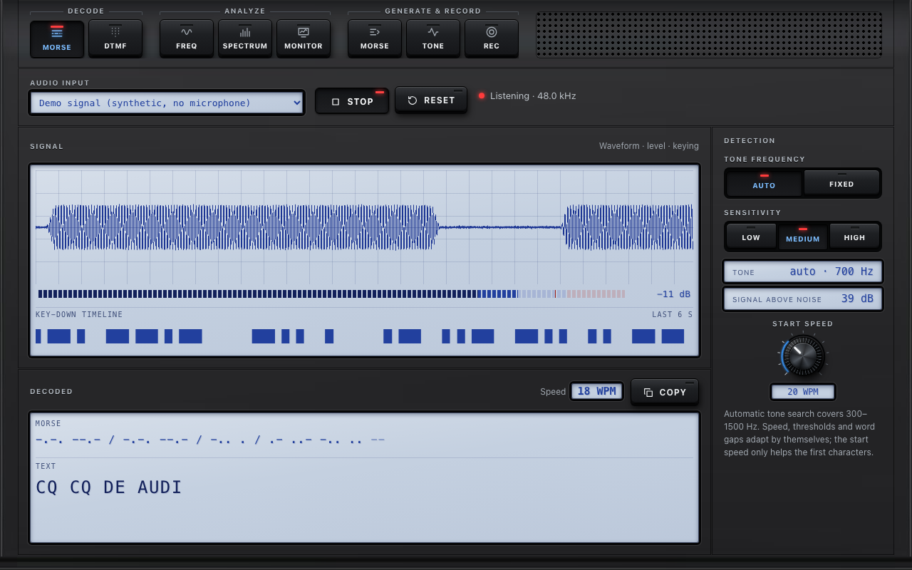
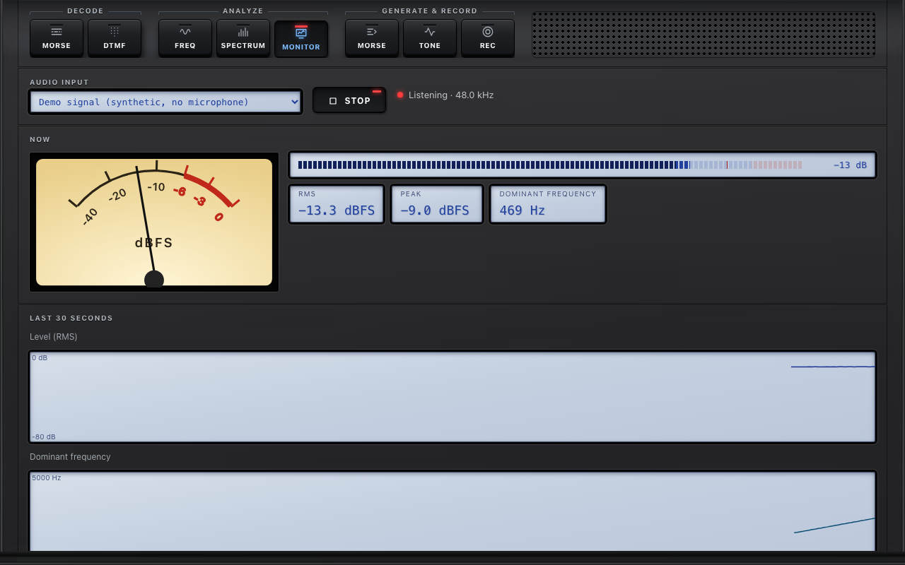
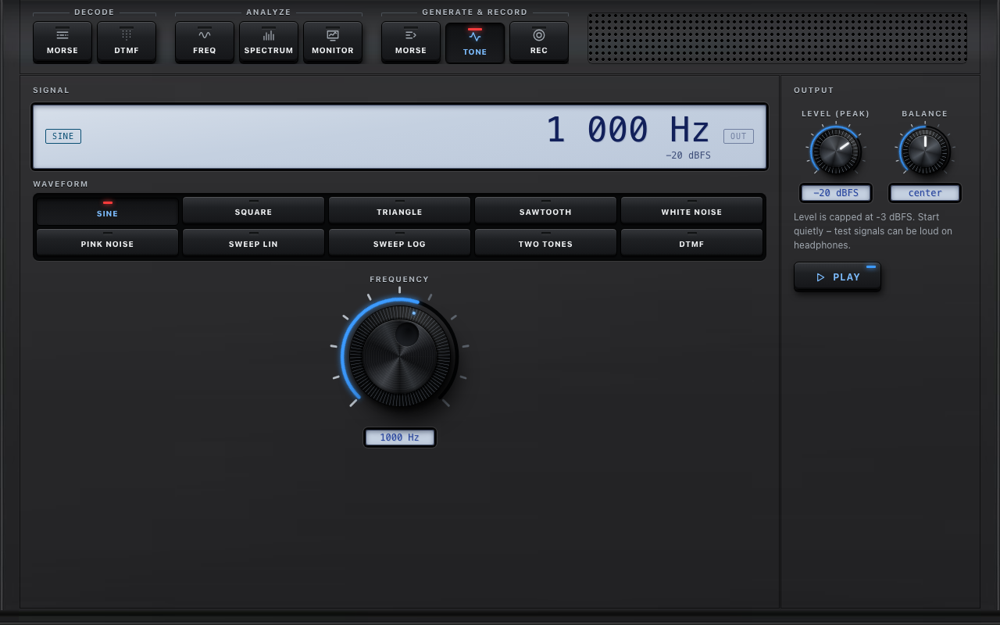
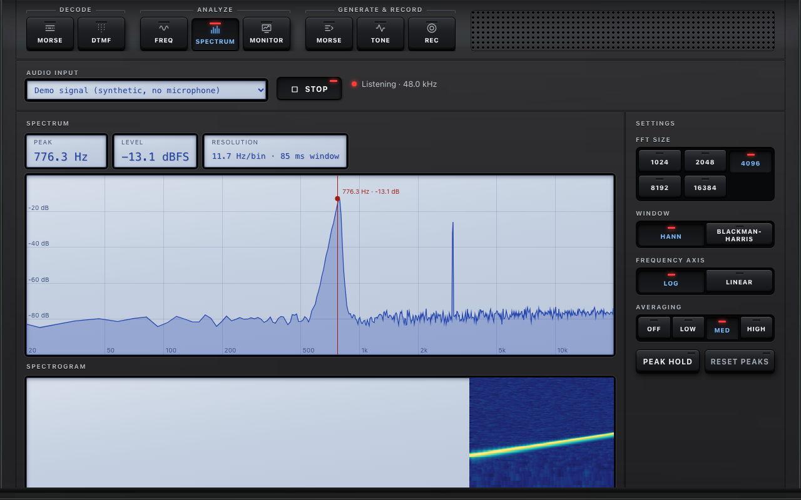
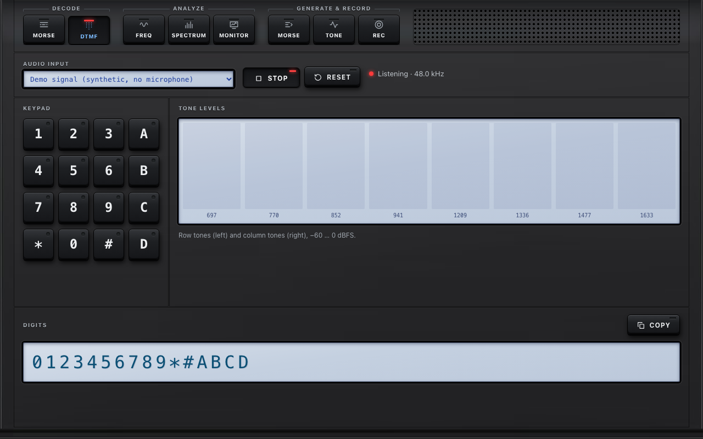

# AudioLab

**Local, privacy-first audio signal analyzer for the web and the desktop.**

AudioLab captures audio from your microphone, visualises it in real time and decodes signals –
Morse code and telephone keypad tones (DTMF) – and comes with a spectrum analyzer, a tone
generator and a recorder. Everything runs on your device: no server, no cloud, no telemetry. The
same Angular application ships as a web app and as a [Tauri 2](https://tauri.app) desktop app for
macOS, Windows and Linux.



## Features

| Module                 | What it does                                                                                                                                                                                              |
| ---------------------- | --------------------------------------------------------------------------------------------------------------------------------------------------------------------------------------------------------- |
| **Morse Decoder**      | Automatic or fixed tone frequency, adaptive threshold and speed (WPM), robust against noise, fading, clicks, sloppy keying and Farnsworth spacing; Morse and plain text output, unknown sequences marked. |
| **DTMF Decoder**       | All 16 keys, ITU-style checks (frequency tolerance, twist, energy ratio), live keypad and tone levels.                                                                                                    |
| **Frequency Analyzer** | Dominant frequency with note name and cents, stability, 10 s history.                                                                                                                                     |
| **Spectrum Analyzer**  | FFT 1024–16384 points, Hann/Blackman-Harris, log/linear axis, averaging, peak hold, spectrogram.                                                                                                          |
| **Signal Monitor**     | RMS/peak level, clipping warning, dominant frequency, 30 s history.                                                                                                                                       |
| **Morse Encoder**      | Text → Morse with live preview and click-free audio playback, Farnsworth spacing.                                                                                                                         |
| **Tone Generator**     | Sine, square, triangle, sawtooth, white/pink noise, sweeps, two-tone and DTMF; level-capped.                                                                                                              |
| **Audio Recorder**     | In-memory recording (10 min max), playback, WAV export (16-bit or 32-bit float).                                                                                                                          |

Every input-based module has a **Demo signal** input, so you can try it without a microphone.

The window is the front panel of an SDR transceiver: one black metal faceplate, a row of mode
keys with indicator LEDs instead of a menu, backlit blue-grey LCDs, latching hardware keys instead
of drop-downs, machined rotary knobs and a spun-metal tuning dial that cast shadows instead of
sliders, and a moving-coil meter. It is always dark – like real hardware – whatever the system
theme. There is no start page: the app opens in the Morse decoder, and a mode key switches
modules.

| Signal monitor                                                      | Tone generator                                                      |
| ------------------------------------------------------------------- | ------------------------------------------------------------------- |
|  |  |

| Spectrum analyzer                                                        | DTMF decoder                                              |
| ------------------------------------------------------------------------ | --------------------------------------------------------- |
|  |  |

## Privacy

- Audio is processed locally and never uploaded; there is no backend and no telemetry.
- The microphone opens only after you press **Start** and is released when you stop, leave the
  view or close the app. While capture runs, the module shows "Listening" and its Stop key is lit.
- Nothing is stored or exported unless you explicitly ask for it.
- The desktop app allows the microphone and nothing else (camera, location, … are denied).

Details: [docs/PRIVACY.md](docs/PRIVACY.md).

## Getting started

**Web:** serve the build over HTTPS (or use `http://localhost` during development) – browsers only
allow microphone access in a secure context. Release builds are attached to GitHub releases as
`audiolab-web-<version>.zip` and can be deployed to GitHub Pages.

**Desktop:** download the installer for your OS from the
[releases page](https://github.com/krocon/sonic-lab/releases). Builds are currently
unsigned; see [docs/BUILDING.md](docs/BUILDING.md#releases) for what that means.

**From source** (Node.js 22.22+/24.15+, pnpm 10; for the desktop app also Rust and the
[Tauri prerequisites](https://tauri.app/start/prerequisites/)):

```bash
pnpm install
pnpm start          # web app on http://localhost:1420
pnpm tauri:dev      # desktop app with live reload
```

## Development

```bash
pnpm test           # unit, integration and signal tests (Vitest)
pnpm test:coverage  # with coverage thresholds
pnpm test:signals   # Morse robustness scenarios (CER limits)
pnpm lint           # ESLint incl. layer boundaries + worklet type-check
pnpm e2e            # Playwright (Chromium); pnpm e2e:all for Firefox and WebKit too
pnpm check          # version sync, scripts, format, lint, tests, web build, Rust checks
pnpm tauri:build    # desktop bundle for the current OS
```

- Architecture: [docs/ARCHITECTURE.md](docs/ARCHITECTURE.md)
- Signal processing and measured accuracy: [docs/AUDIO-PIPELINE.md](docs/AUDIO-PIPELINE.md)
- Tests: [docs/TESTING.md](docs/TESTING.md) · Building and releases: [docs/BUILDING.md](docs/BUILDING.md)
- Roadmap: [docs/ROADMAP.md](docs/ROADMAP.md) · Contributing: [CONTRIBUTING.md](CONTRIBUTING.md)

The development history is documented as work orders in [prompts/](prompts/README.md).

## Browser support

Current desktop versions of Chromium-based browsers, Firefox and Safari. AudioLab needs
`getUserMedia`, the Web Audio API and `AudioWorklet`; unsupported or insecure environments get a
clear message instead of a broken page. Automated tests run in Chromium locally and in Chromium,
Firefox and WebKit in CI.

## License

[MIT](LICENSE) © 2026 Marc Kronberg
